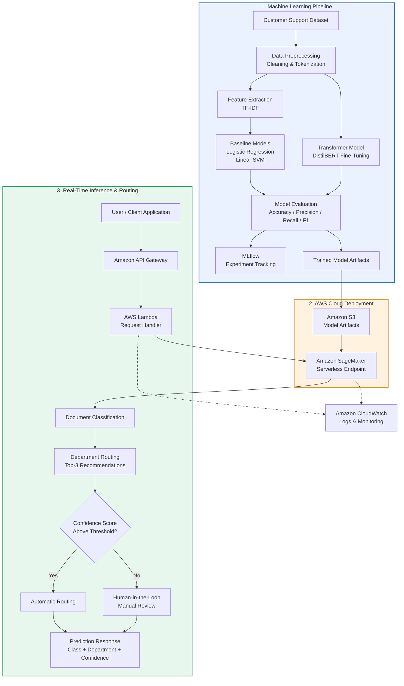

# 📄 AI Document Classification & Routing System


## 📌 Project Overview
Organizations receive large volumes of incoming documents such as complaints, requests, and invoices. Manual sorting is slow, prone to errors, and scales poorly as document volume grows. 

This project builds an end-to-end **AI Document Classification & Routing System** that reads the text of an incoming document and automatically recommends the appropriate department to handle it. Low-confidence predictions are flagged for human review, ensuring a balanced approach between automation and human accuracy.

## 🏗️ System Architecture


## 🎯 Key Features
* **Document Type Classification:** Automatically classifies documents into predefined types (e.g., Incident, Request, Problem, Change).
* **Smart Routing (Top-3 Departments):** Recommends the 3 most likely departments to handle the document, complete with confidence scores.
* **Human-in-the-Loop:** Flags uncertain or low-confidence documents for manual review.
* **Cloud-Native Inference (planned):** Deployment on AWS using a serverless architecture for scalable, cost-effective inference.

## 📊 Dataset

* **Source:** [Tobi-Bueck/customer-support-tickets](https://huggingface.co/datasets/Tobi-Bueck/customer-support-tickets) on Hugging Face, by Tobias Bueck.
* **File used:** `aa_dataset-tickets-multi-lang-5-2-50-version.csv` (28,587 tickets; the 16,338 English tickets are used).
* **Labels:** 4 document types (`type`) and 10 departments (`queue`).
* **License:** [CC BY-NC 4.0](https://creativecommons.org/licenses/by-nc/4.0/). The data is used for educational, non-commercial purposes only and is **not redistributed** in this repository.
* **Note:** The tickets are synthetic (generated), not real customer messages. Results may not reflect real-world performance.

To get the data, download the file above and place it in `data/raw/`.

## 📂 Repository Structure
```text
NHA-5-168/
├── README.md               # Project overview, setup instructions, and team info
├── LICENSE                 # MIT license for the code
├── requirements.txt        # Python dependencies (development)
├── requirements-aws.txt    # SageMaker deployment tools (Linux/Mac only)
├── .gitignore              # Ignored files (data, models, MLflow runs, secrets)
├── config.yaml             # Centralized configuration and paths
│
├── data/                   # Local data folder (files not uploaded to GitHub)
│   ├── raw/                # Raw downloaded dataset
│   └── processed/          # Cleaned and split datasets (train/val/test)
│
├── notebooks/              # Jupyter notebooks for experimentation
│   ├── 01_eda.ipynb        # Exploratory Data Analysis
│   ├── 02_baseline.ipynb   # TF-IDF & classical ML experiments
│   └── 03_transformer.ipynb # DistilBERT experiments
│
├── src/                    # Production-ready source code
│   ├── preprocess.py       # Text cleaning, filtering, de-duplication, splitting
│   ├── train_baseline.py   # Baseline model training script
│   ├── train_transformer.py # Transformer fine-tuning script
│   ├── evaluate.py         # Evaluation metrics (Macro F1, Top-3, confusion matrix)
│   ├── predict.py          # Inference function predict() (used locally and on SageMaker)
│   └── api.py              # Local FastAPI app that calls predict()
│
├── tests/                  # Unit tests (pytest)
│
├── aws/                    # Cloud deployment scripts
│   ├── lambda_handler.py   # AWS Lambda function code
│   └── deploy_endpoint.py  # SageMaker deployment script
│
└── docs/                   # Project documents
    ├── Business_Requirements.md
    ├── SRS.md              # Software Requirements Specification
    ├── PIPELINE.md         # Project pipeline and timeline
    └── architecture.md     # System architecture diagrams and workflows
```

## 📸 System in Action

*(screenshots once the UI/Demo is ready)*

### 1. Classification Results & Top-3 Departments

*Shows the system predicting the document type and recommending the top 3 departments with confidence scores.*


### 2. Human Review Flag (Low Confidence)

*Demonstrates how the system flags a document for manual review when the confidence score falls below the accepted threshold.*


## 📊 Model Performance Comparison

All models are trained and evaluated on the exact same train/validation/test split. Department routing is the harder task, so it is reported with three metrics: accuracy, **macro F1** (every department counts equally, because the departments are imbalanced), and **top-3 accuracy** (the correct department is among the three suggestions).

**Department routing (10 departments)**

| Model | Accuracy | Macro F1 | Top-3 Accuracy |
| --- | --- | --- | --- |
| Majority class (reference) | TBD | TBD | — |
| Most-frequent top-3 (reference) | — | — | TBD |
| **Logistic Regression** | TBD | TBD | TBD |
| **Linear SVM** | TBD | TBD | TBD |
| **DistilBERT (Advanced)** | TBD | TBD | TBD |

**Document type (4 types)**

| Model | Accuracy | Macro F1 |
| --- | --- | --- |
| Majority class (reference) | TBD | TBD |
| **Logistic Regression** | TBD | TBD |
| **Linear SVM** | TBD | TBD |
| **DistilBERT (Advanced)** | TBD | TBD |

*(Values will be filled in from the recorded MLflow runs after the training and evaluation phases.)*

## 🛠️ Technology Stack

* **Data Processing:** Pandas, PyArrow (Parquet), PyYAML
* **Baseline Modeling:** Scikit-learn (TF-IDF, Logistic Regression, Linear SVM)
* **Advanced Modeling:** Hugging Face Transformers (DistilBERT fine-tuning)
* **Experiment Tracking:** MLflow
* **Backend & Local API:** Python 3.11, FastAPI (for local testing without AWS costs)
* **Cloud Deployment (AWS):** S3, SageMaker Serverless Endpoints, AWS Lambda, API Gateway, CloudWatch

## 🚀 How to Run the Project

You can run this project locally without incurring AWS costs, or deploy it fully to the cloud.

### 1. Local Development (Without AWS)

This mode uses a locally trained model and serves it via a local **FastAPI** application for testing.

**Step 1: Clone the repository & install dependencies**

```bash
git clone https://github.com/nhahub/NHA-5-168.git
cd NHA-5-168
python -m venv .venv
.venv\Scripts\activate      # Windows (Linux/Mac: source .venv/bin/activate)
pip install -r requirements.txt

```

**Step 2: Data Preprocessing & Training**
*(Note: Requires placing the dataset in `data/raw/` first)*

```bash
python src/preprocess.py
python src/train_baseline.py

```

**Step 3: Run the Local API Server**

```bash
uvicorn src.api:app --reload

```

You can now test predictions locally by sending POST requests to `http://localhost:8000/predict`.

### 2. Cloud Production (AWS Deployment)

For production, the local FastAPI server is replaced by native AWS services.

1. The trained model artifacts are uploaded to an **Amazon S3** bucket.
2. The deployment script creates a **SageMaker Serverless Endpoint**.
3. **AWS Lambda** and **API Gateway** are provisioned to expose the model securely over the internet.

## 👥 Team Members

This project is developed for the **Digital Egypt Pioneers Initiative (DEPI)**.

* **Ahmed Mahmoud Mostafa Abdelkarim** 
* **Abdelrahman Mohamed Ezz**

## 📜 License

The code in this repository is released under the [MIT License](LICENSE).
The dataset is not part of this repository and keeps its own license (CC BY-NC 4.0).
